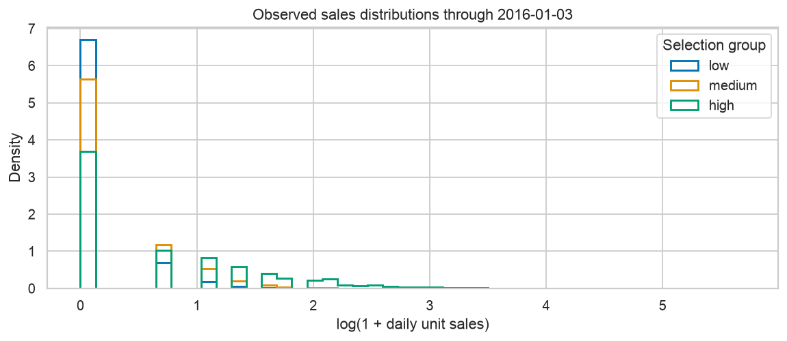
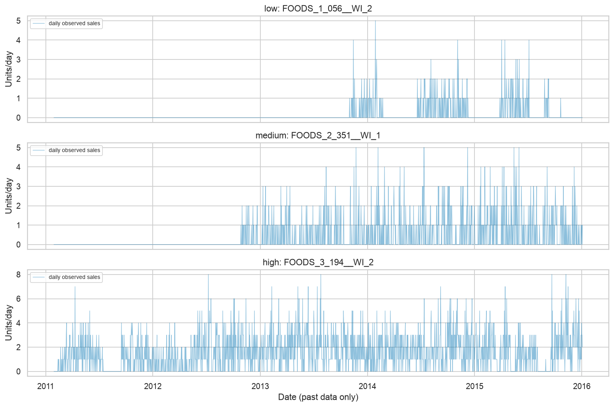
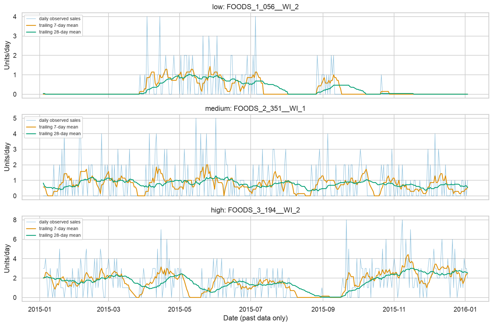
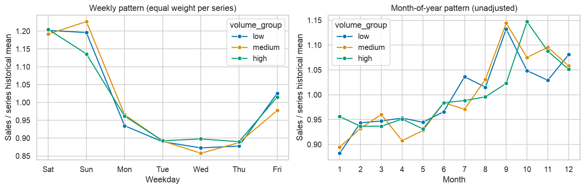
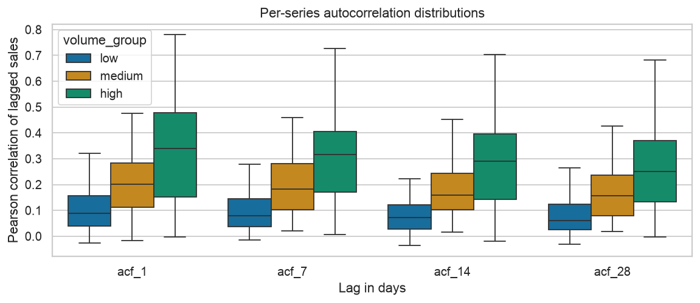
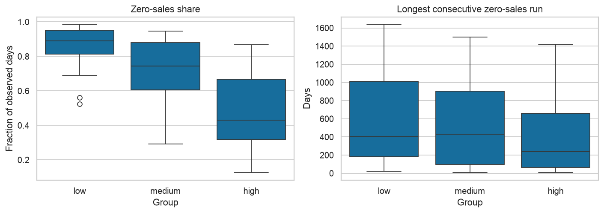
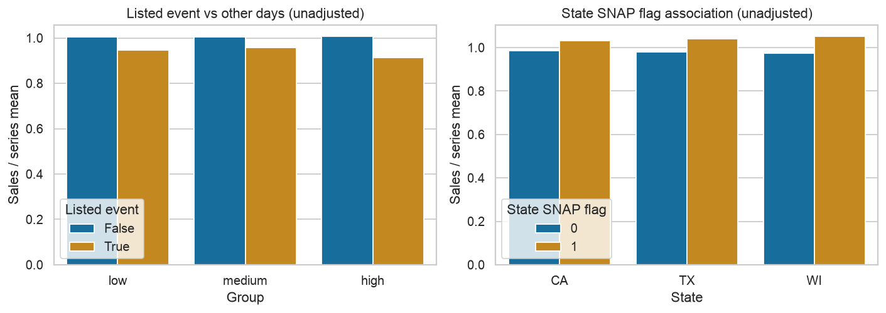
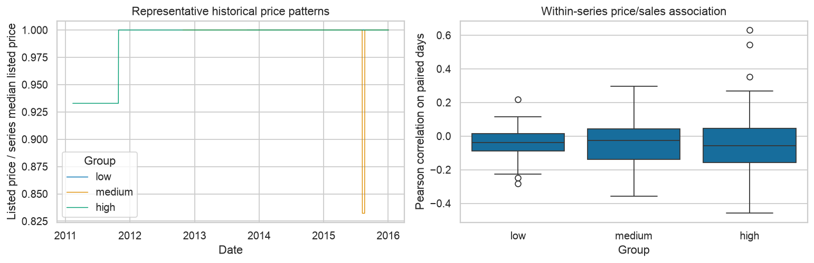

# EDA findings

All observations are from **d_1–d_1801**, 2011-01-29–2016-01-03: 432,240 rows, 240 selected series. Nothing after the first development origin is used for statistics, representative-series choice, rolling averages or figures. Selection uses only the trailing 365 days at that origin; EDA describes all preceding available history. No holdout target is inspected here.

## 1. Volume and variability differ across the selected groups

**Observed:** Median per-series historical mean unit sales/day: low: 0.145, medium: 0.421, high: 1.574. The group summary below reports standard-deviation/mean variability as well as sparsity. Per-series mean, median, sample variance, sample standard deviation, maximum and CV are in `eda_series_statistics.csv`.

**Evidence:** Figure 01 and the table below; group membership came from a different, trailing-365-day mean, so these full-history summaries need not have perfectly disjoint ranges.

**Forecasting relevance:** Scale differences justify reporting a common pooled metric alongside per-group diagnostics in later milestones. A global model may share information while per-series models face different signal levels.

**Cannot conclude:** Stratified selection is not representative of all M5 series; larger volume does not prove easier prediction, and these summaries do not establish any model's performance.

## 2. Calendar structure and persistence are present but heterogeneous

**Observed:** Equal-series normalized weekday peak/trough ratio is 1.369. Median per-series sales autocorrelations are {'1': 0.1727614923806651, '7': 0.16390045053831753, '14': 0.14589667007910778, '28': 0.13482013453338512}. Weekly and monthly profiles and representative trailing 7/28-day averages are plotted.

**Evidence:** Figures 02–05; `eda_weekday.csv` and `eda_monthly.csv`. Monthly means are month-of-year descriptions, not a detrended seasonality decomposition.

**Forecasting relevance:** Calendar covariates and a weekly seasonal naive reference will be reasonable hypotheses to test. Rolling plots separate short-term noise from longer changes descriptively.

**Cannot conclude:** Autocorrelation may reflect trends, prelaunch stretches or changing availability; pooled profiles do not guarantee stable seasonality or out-of-sample gains. No forecasting model was fitted.

## 3. Zeros and intermittent behavior require care

**Observed:** Median per-series zero-sales shares: low: 89.1%, medium: 74.4%, high: 43.0%. Across selected series, 69.3% of observed days have zero sales; the longest zero run is 1640 days. Descriptive patterns: {'intermittent': 175, 'lumpy': 54, 'smooth': 8, 'erratic': 3}.

**Evidence:** Figure 06 and per-series zero fractions, longest zero runs, average inter-demand intervals (ADI), and squared CV of positive sales. ADI is observed days / positive-sale days; classification thresholds are configurable (1.32, 0.49). All-zero and insufficient-positive-sale cases are explicit.

**Forecasting relevance:** Intermittency and long zero runs can make percentage metrics unstable, motivate count-aware uncertainty later, and challenge smooth per-series state models.

**Cannot conclude:** Zero sales are not confirmed stockouts or zero latent demand. Long zero runs can include an unobserved launch period. The descriptive classifications are not established product labels and do not filter out sparse series.

## 4. Event and SNAP associations are descriptive

**Observed:** State SNAP-flagged-day / other-day normalized mean ratios are {'CA': 1.048, 'TX': 1.06, 'WI': 1.08}. Event-day and non-event-day comparisons are reported by volume group, with named-event counts in `eda_named_events.csv`.

**Evidence:** Figure 07, `eda_events.csv`, `eda_snap.csv`, and `eda_named_events.csv`. Normalization gives series equal scale before exposure summaries; no weekday, price, season, trend or assortment adjustment is made.

**Forecasting relevance:** Known holidays/events are legitimate candidate future covariates. The initial availability policy conservatively uses SNAP only historically and excludes future SNAP until a realistic schedule assumption is documented.

**Cannot conclude:** These comparisons do not identify causal holiday or SNAP effects. Groups have unequal exposures, repeated observations and confounding; no significance test or independent-sample assumption is claimed.

## 5. Prices vary, and missing listings create availability uncertainty

**Observed:** Historical price-missing fraction is 24.4%. There are 159 usable within-series price/sales correlations (minimum 30 paired days, nonconstant price and sales), with median -0.047. Distinct price counts and ranges are saved per series.

**Evidence:** Figure 08 and `eda_series_statistics.csv`. Correlations are computed within series on days with both observed sales and listed price; omitted undefined correlations are not treated as zero.

**Forecasting relevance:** Historical price can be useful context, but future actual prices are excluded from all forecast-input objects. Missing listings and launch/availability uncertainty should remain explicit quality flags.

**Cannot conclude:** The correlation is not a causal price elasticity: promotions, trends, seasonality and stock conditions can confound it. Missing price records do not prove unavailability. Weekly repeated price observations are not independent daily price experiments.

## Group evidence

| volume_group | series | median_mean | median_cv | median_zero_fraction | median_max_zero_run | median_acf_7 | median_price_corr |
| --- | --- | --- | --- | --- | --- | --- | --- |
| low | 80 | 0.1449 | 3.2745 | 0.8906 | 403.5 | 0.0801 | -0.0385 |
| medium | 80 | 0.4209 | 2.2036 | 0.7438 | 430.0 | 0.1819 | -0.0263 |
| high | 80 | 1.5738 | 1.4603 | 0.4303 | 236.5 | 0.3164 | -0.056 |

## Figures and reproducibility

Run `python -m src.data.eda` after preprocessing, or execute `notebooks/02_eda.ipynb`. All statistics tables and figures are regenerated from the cutoff-safe panel. Sample variances use ddof=1; lag correlations are pairwise finite; constant-series correlations and zero-mean CV are undefined (NA), not silently set to zero. No imputation, causal estimation, fitted preprocessing or forecasting model is performed.
